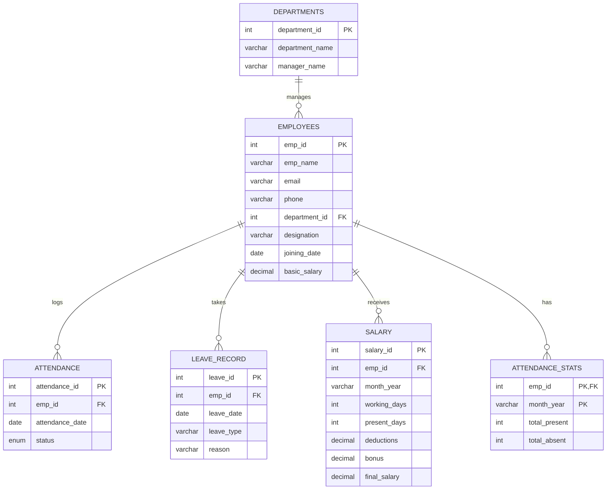

# Employee Attendance & Payroll Analytics System

## 1. Project Overview

This database-driven system is designed to manage employee records, track daily attendance, handle leave requests, and automate monthly salary calculations. It is structured to be scalable and demonstrates strong relational database principles. 
---

## 2. ER Diagram & Database Schema



---

## 3. Core DBMS Concepts Demonstrated

1. **Normalization (Up to 3NF):** Data is separated into distinct logical tables to prevent redundancy (e.g., Department details are stored once in `Departments`, not repeated for every employee).
2. **Primary & Foreign Keys (Referential Integrity):** Used to establish relationships. If a department is deleted, associated employees' `department_id` is set to NULL (`ON DELETE SET NULL`), preventing orphan records.
3. **Constraints:** 
   - `UNIQUE` to ensure no duplicate emails.
   - `CHECK` to ensure salaries and working days are positive numbers.
   - `DEFAULT` values for standard operations.
4. **Joins & Aggregate Functions:** Used extensively in reporting queries to compile data across multiple tables.
5. **Views:** Virtual tables created to simplify complex reporting (e.g., Monthly Payroll).
6. **Stored Procedures:** Reusable SQL blocks to automate the math behind salary calculations.
7. **Triggers:** Automated background actions used to validate data before insertion and update statistics tables dynamically.

---

## 4. SQL DDL (Schema Setup)

```sql
CREATE DATABASE PayrollDB;
USE PayrollDB;

-- 1. Departments Table
CREATE TABLE Departments (
    department_id INT AUTO_INCREMENT PRIMARY KEY,
    department_name VARCHAR(100) NOT NULL UNIQUE,
    manager_name VARCHAR(100) NOT NULL
);

-- 2. Employees Table
CREATE TABLE Employees (
    emp_id INT AUTO_INCREMENT PRIMARY KEY,
    emp_name VARCHAR(100) NOT NULL,
    email VARCHAR(100) UNIQUE NOT NULL,
    phone VARCHAR(15) UNIQUE,
    department_id INT,
    designation VARCHAR(50) NOT NULL,
    joining_date DATE NOT NULL,
    basic_salary DECIMAL(10, 2) CHECK (basic_salary > 0),
    FOREIGN KEY (department_id) REFERENCES Departments(department_id) ON DELETE SET NULL
);

-- 3. Attendance Table
CREATE TABLE Attendance (
    attendance_id INT AUTO_INCREMENT PRIMARY KEY,
    emp_id INT NOT NULL,
    attendance_date DATE NOT NULL,
    status ENUM('Present', 'Absent', 'Leave') NOT NULL DEFAULT 'Present',
    FOREIGN KEY (emp_id) REFERENCES Employees(emp_id) ON DELETE CASCADE,
    UNIQUE (emp_id, attendance_date) -- Prevents duplicate attendance entries per day
);

-- 4. Leave Record Table
CREATE TABLE Leave_Record (
    leave_id INT AUTO_INCREMENT PRIMARY KEY,
    emp_id INT NOT NULL,
    leave_date DATE NOT NULL,
    leave_type VARCHAR(50) NOT NULL,
    reason TEXT,
    FOREIGN KEY (emp_id) REFERENCES Employees(emp_id) ON DELETE CASCADE
);

-- 5. Salary Table
CREATE TABLE Salary (
    salary_id INT AUTO_INCREMENT PRIMARY KEY,
    emp_id INT NOT NULL,
    month_year VARCHAR(7) NOT NULL, -- Format: 'YYYY-MM'
    working_days INT NOT NULL CHECK (working_days >= 0),
    present_days INT NOT NULL CHECK (present_days >= 0),
    deductions DECIMAL(10, 2) DEFAULT 0.00,
    bonus DECIMAL(10, 2) DEFAULT 0.00,
    final_salary DECIMAL(10, 2) NOT NULL,
    FOREIGN KEY (emp_id) REFERENCES Employees(emp_id) ON DELETE CASCADE,
    UNIQUE (emp_id, month_year) -- One salary record per month per employee
);

-- Auxiliary Table for Trigger Demonstration
CREATE TABLE Attendance_Stats (
    emp_id INT,
    month_year VARCHAR(7),
    total_present INT DEFAULT 0,
    total_absent INT DEFAULT 0,
    PRIMARY KEY (emp_id, month_year),
    FOREIGN KEY (emp_id) REFERENCES Employees(emp_id) ON DELETE CASCADE
);
```

---

## 5. Sample Data Insertion (DML)

```sql
-- Insert Departments
INSERT INTO Departments (department_name, manager_name) VALUES 
('Engineering', 'Alice Smith'),
('Human Resources', 'Bob Johnson'),
('Sales', 'Charlie Brown'),
('Marketing', 'Diana Prince'),
('Finance', 'Evan Wright');

-- Insert Employees
INSERT INTO Employees (emp_name, email, phone, department_id, designation, joining_date, basic_salary) VALUES
('John Doe', 'john@company.com', '555-0101', 1, 'Software Engineer', '2022-01-15', 80000),
('Jane Roe', 'jane@company.com', '555-0102', 1, 'Senior Engineer', '2021-03-10', 110000),
('Sam Fisher', 'sam@company.com', '555-0103', 2, 'HR Specialist', '2023-06-01', 60000),
('Lucy Lawless', 'lucy@company.com', '555-0104', 3, 'Sales Lead', '2020-11-20', 75000),
('Tom Hardy', 'tom@company.com', '555-0105', 4, 'Marketing Manager', '2019-08-05', 90000);

-- Insert Leave Records
INSERT INTO Leave_Record (emp_id, leave_date, leave_type, reason) VALUES
(1, '2023-10-15', 'Sick Leave', 'Flu'),
(3, '2023-10-20', 'Casual Leave', 'Personal Work');

-- Insert Attendance
INSERT INTO Attendance (emp_id, attendance_date, status) VALUES
(1, '2023-10-01', 'Present'), (1, '2023-10-02', 'Present'), (1, '2023-10-03', 'Absent'),
(2, '2023-10-01', 'Present'), (2, '2023-10-02', 'Present'), (2, '2023-10-03', 'Present'),
(3, '2023-10-01', 'Present'), (3, '2023-10-02', 'Absent'); 
```

---

## 6. Views

Views hide complex queries and provide clean interfaces for reports.

```sql
-- 1. Employee Attendance Report View
CREATE VIEW VW_Employee_Attendance_Report AS
SELECT 
    e.emp_id, 
    e.emp_name, 
    d.department_name, 
    DATE_FORMAT(a.attendance_date, '%Y-%m') AS Month,
    COUNT(CASE WHEN a.status = 'Present' THEN 1 END) as Total_Present,
    COUNT(CASE WHEN a.status = 'Absent' THEN 1 END) as Total_Absent
FROM Employees e
JOIN Departments d ON e.department_id = d.department_id
LEFT JOIN Attendance a ON e.emp_id = a.emp_id
GROUP BY e.emp_id, e.emp_name, d.department_name, Month;

-- 2. Monthly Payroll Report View
CREATE VIEW VW_Monthly_Payroll_Report AS
SELECT 
    s.month_year,
    e.emp_name,
    d.department_name,
    s.working_days,
    s.present_days,
    e.basic_salary,
    s.deductions,
    s.final_salary
FROM Salary s
JOIN Employees e ON s.emp_id = e.emp_id
JOIN Departments d ON e.department_id = d.department_id;

-- 3. Department Salary Analysis View
CREATE VIEW VW_Department_Salary_Analysis AS
SELECT 
    d.department_name,
    COUNT(e.emp_id) as Employee_Count,
    AVG(e.basic_salary) as Avg_Basic_Salary,
    SUM(s.final_salary) as Total_Expense
FROM Departments d
LEFT JOIN Employees e ON d.department_id = e.department_id
LEFT JOIN Salary s ON e.emp_id = s.emp_id
GROUP BY d.department_name;
```

---

## 7. Stored Procedures

Procedures encapsulate business logic. This procedure calculates salary dynamically based on attendance.

```sql
DELIMITER //

CREATE PROCEDURE CalculateMonthlySalary(IN p_emp_id INT, IN p_month_year VARCHAR(7))
BEGIN
    DECLARE v_basic_salary DECIMAL(10, 2);
    DECLARE v_present_days INT;
    DECLARE v_working_days INT DEFAULT 22; -- Assuming 22 working days in a month
    DECLARE v_deductions DECIMAL(10, 2) DEFAULT 0;
    DECLARE v_final_salary DECIMAL(10, 2);

    -- Fetch basic salary
    SELECT basic_salary INTO v_basic_salary FROM Employees WHERE emp_id = p_emp_id;

    -- Calculate total present days for the given month
    SELECT COUNT(*) INTO v_present_days 
    FROM Attendance 
    WHERE emp_id = p_emp_id 
    AND DATE_FORMAT(attendance_date, '%Y-%m') = p_month_year 
    AND status = 'Present';

    -- Calculate deductions (prorated by missing days)
    IF v_present_days < v_working_days THEN
        SET v_deductions = (v_basic_salary / v_working_days) * (v_working_days - v_present_days);
    END IF;

    SET v_final_salary = v_basic_salary - v_deductions;

    -- Insert or Update the Salary table (Upsert)
    INSERT INTO Salary (emp_id, month_year, working_days, present_days, deductions, final_salary)
    VALUES (p_emp_id, p_month_year, v_working_days, v_present_days, v_deductions, v_final_salary)
    ON DUPLICATE KEY UPDATE 
        present_days = v_present_days, 
        deductions = v_deductions, 
        final_salary = v_final_salary;
END //

DELIMITER ;

-- How to run it: CALL CalculateMonthlySalary(1, '2023-10');
```

---

## 8. Triggers

Triggers ensure data integrity automatically in the background.

```sql
DELIMITER //

-- Trigger 1: Validate attendance entries (Prevent future dates)
CREATE TRIGGER Before_Attendance_Insert
BEFORE INSERT ON Attendance
FOR EACH ROW
BEGIN
    IF NEW.attendance_date > CURDATE() THEN
        SIGNAL SQLSTATE '45000' 
        SET MESSAGE_TEXT = 'Error: Cannot log attendance for a future date.';
    END IF;
END //

-- Trigger 2: Automatically update attendance statistics after insertion
CREATE TRIGGER After_Attendance_Insert
AFTER INSERT ON Attendance
FOR EACH ROW
BEGIN
    DECLARE v_month VARCHAR(7);
    SET v_month = DATE_FORMAT(NEW.attendance_date, '%Y-%m');
    
    INSERT INTO Attendance_Stats (emp_id, month_year, total_present, total_absent)
    VALUES (
        NEW.emp_id, 
        v_month, 
        IF(NEW.status = 'Present', 1, 0), 
        IF(NEW.status = 'Absent', 1, 0)
    )
    ON DUPLICATE KEY UPDATE 
        total_present = total_present + IF(NEW.status = 'Present', 1, 0),
        total_absent = total_absent + IF(NEW.status = 'Absent', 1, 0);
END //

DELIMITER ;
```

---

## 9. Required SQL Queries

These queries answer business questions and showcase analytical SQL skills (GROUP BY, HAVING, subqueries).

**1. Employee Attendance Report**
```sql
SELECT * FROM VW_Employee_Attendance_Report;
```

**2. Attendance Percentage Calculation**
```sql
SELECT 
    emp_name, 
    Month,
    Total_Present, 
    (Total_Present + Total_Absent) as Total_Days,
    ROUND((Total_Present / (Total_Present + Total_Absent)) * 100, 2) AS Attendance_Percentage
FROM VW_Employee_Attendance_Report;
```

**3. Employees with Attendance Below 75%**
```sql
SELECT emp_name, Month 
FROM VW_Employee_Attendance_Report
WHERE (Total_Present / (Total_Present + Total_Absent)) < 0.75;
```

**4. Department-wise Employee Count**
```sql
SELECT d.department_name, COUNT(e.emp_id) AS Employee_Count
FROM Departments d
LEFT JOIN Employees e ON d.department_id = e.department_id
GROUP BY d.department_name;
```

**5. Department-wise Average Salary**
```sql
SELECT department_name, Avg_Basic_Salary 
FROM VW_Department_Salary_Analysis;
```

**6. Highest Paid Employee**
```sql
SELECT emp_name, designation, basic_salary 
FROM Employees 
ORDER BY basic_salary DESC 
LIMIT 1;

-- Alternative using Subquery:
-- SELECT emp_name FROM Employees WHERE basic_salary = (SELECT MAX(basic_salary) FROM Employees);
```

**7. Top 10 Employees by Attendance (For a specific month)**
```sql
SELECT e.emp_name, s.total_present 
FROM Attendance_Stats s
JOIN Employees e ON s.emp_id = e.emp_id
WHERE s.month_year = '2023-10'
ORDER BY s.total_present DESC
LIMIT 10;
```

**8. Monthly Payroll Report**
```sql
SELECT * FROM VW_Monthly_Payroll_Report WHERE month_year = '2023-10';
```

**9. Employees Taking Most Leaves**
```sql
SELECT e.emp_name, COUNT(l.leave_id) AS Total_Leaves_Taken
FROM Employees e
JOIN Leave_Record l ON e.emp_id = l.emp_id
GROUP BY e.emp_id, e.emp_name
HAVING Total_Leaves_Taken > 0
ORDER BY Total_Leaves_Taken DESC;
```

**10. Total Salary Expense by Department**
```sql
SELECT department_name, Total_Expense 
FROM VW_Department_Salary_Analysis;
```
